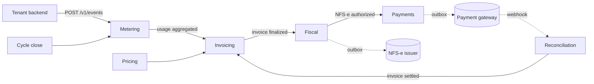

# usage-billing-engine

Usage-based billing for startups that charge by consumption, built for the Brazilian market: usage events in, monthly cycle closes, invoice out, NFS-e issued, Pix or boleto charge created, payment reconciled.

> Status: early development. Architecture and scope are defined; features are being built task by task.

## How it works



A modular monolith (Spring Modulith): each module owns its data and talks to the others through domain events. External calls (fiscal issuer, payment gateway) go through an outbox with timeout, retry and circuit breaker.

## Key decisions

- Idempotent ingestion keyed by `(tenant, transaction_id)`; late events never dropped.
- `BigDecimal` money, rounding once per invoice line; UTC storage, periods in `America/Sao_Paulo`.
- NFS-e issued at invoice finalization; the charge is only created once the NFS-e is authorized.
- Fiscal issuer and payment gateway behind ports, with local simulators by default. No certificate or real tax id is needed to run the project.

Architecture decisions are recorded in [`docs/adr`](docs/adr). Domain terms are in [`CONTEXT.md`](CONTEXT.md).

## Stack

Java 25 · Spring Boot 4.1 · Spring Modulith · PostgreSQL + TimescaleDB · Flyway · OpenTelemetry + Grafana · springdoc · JUnit 5, jqwik, Testcontainers, WireMock · Gradle (Kotlin DSL)

## Running locally

Requirements: Docker and a JDK (Gradle provisions Java 25 through the toolchain).

```bash
./gradlew bootRun     # starts Postgres/TimescaleDB and Grafana via compose.yaml
./gradlew check       # tests, including module boundary verification
```

- API docs: http://localhost:8080/swagger-ui.html
- Grafana: http://localhost:3000

## Out of scope (for now)

Customer portal, Pix Automático, prepaid credits, proration, refunds and credit notes, per-tenant certificates, self-service onboarding.

## AI-assisted development

This repository uses Harness PRO (`CLAUDE.md`, `.claude/`, `.harness/`): role-based agents, skills and workflows that keep AI-assisted work spec-driven and verified.

## License

[MIT](LICENSE)
